# Sistema de Automatización RIPS


Aplicación web que permite a usuarios **no técnicos** (auditoría, facturación, jurídica) generar por sí mismos reportes **RIPS** (Registros Individuales de Prestación de Servicios de Salud) a partir de **4 bases de datos históricas**, sin intervención de TI.

> **Contexto:** proyecto desarrollado de forma individual para **Savia Salud EPS** (Colombia). Un proceso que tomaba **2–5 días** de trabajo técnico pasó a ser una consulta autoservicio de **minutos**.

> ⚠️ **Repositorio de portafolio, no ejecutable.** El sistema depende de bases de datos de producción privadas a las que ya no tengo acceso. Las capturas de esta página provienen de la aplicación funcionando, y los datos personales fueron anonimizados.

---

## 📌 Resumen

| | |
|---|---|
| **Problema** | Extraer RIPS exigía que un técnico consultara manualmente varias BDs con esquemas distintos, consolidara, depurara y enviara archivos. |
| **Solución** | Wizard de 5 pasos + pipeline ETL que enruta, consolida, normaliza, deduplica, enriquece y exporta automáticamente. |
| **Tipos RIPS** | AC (Consultas) · AP (Procedimientos) · AM (Medicamentos) |
| **Normativas** | Resolución 3374/2000 (legacy, TXT) y 2275/2023 (JSON) |
| **Fuentes** | 4 conexiones: 3 MySQL + 1 PostgreSQL |
| **Salida** | CSV UTF-8 BOM, separador `\|`, nomenclatura oficial `RIPS_{TIPO}_{NORMATIVA}_{YYYYMMDD}.csv` |
| **Stack** | Python · Dash 3.3 · SQLAlchemy · pandas · MySQL · PostgreSQL |

## 📈 Resultados medibles

| Métrica | Resultado |
|---|---|
| Tiempo de entrega de un reporte | De **2–5 días** a **minutos** |
| Caso real (AC, 3374, 291 días, 9 diagnósticos) | **4,030 registros en 137.8 s** (ver [captura](#5-resultado-y-descarga)) |
| Consolidación del año 2020 (3 BDs) | 14,210 registros brutos → **12,770** únicos (**1,440 duplicados** eliminados) |
| Eliminación del `COUNT` preliminar | **145.8 s → 74.6 s (−49 %)** |
| Pool de conexiones por BD | **−40 a 60 %** de latencia frente a conexiones bajo demanda |
| Seguridad SQL | **100 %** de queries parametrizadas |

---

## 🖥️ Demo del flujo (capturas reales)

La aplicación guía al usuario en 5 pasos con validación progresiva. Las capturas corresponden a una consulta real de **AC · Res. 3374**.

### 1. Inicio
Presenta las capacidades del sistema: normativas, tipos RIPS, filtros avanzados y exportación.

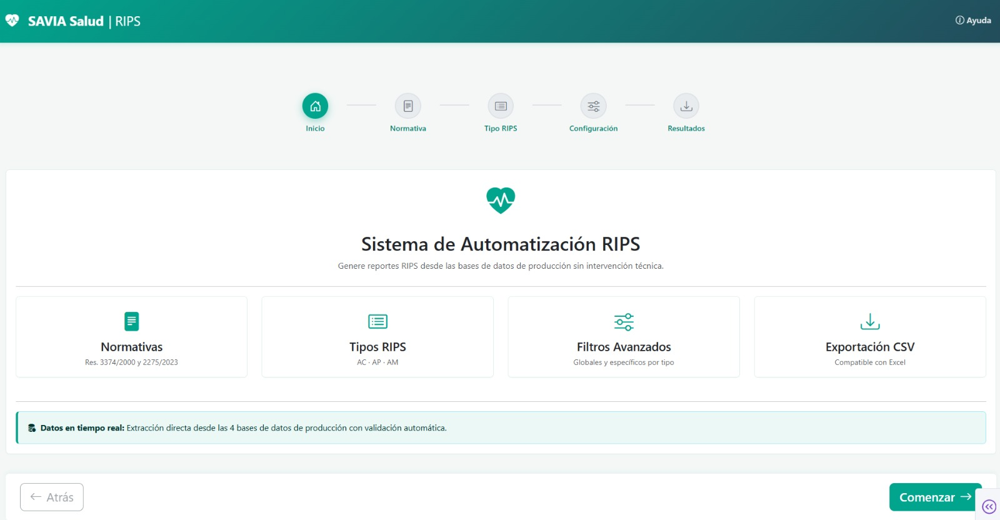

### 2. Normativa y 3. Tipo RIPS
El usuario elige la resolución aplicable y un tipo de RIPS. **Una consulta genera un solo tipo**, decisión de diseño para simplificar la UX y las validaciones.

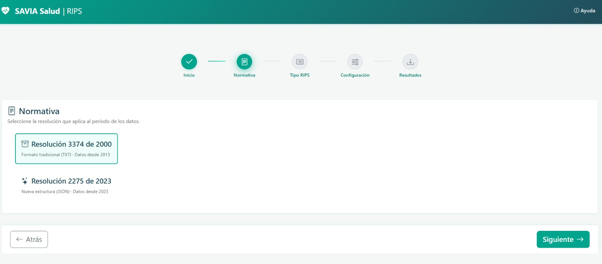
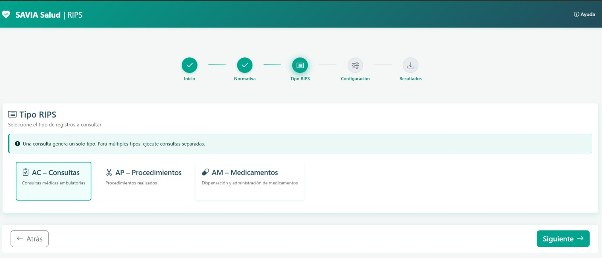

### 4. Configuración de la consulta
Tres paneles: **filtros globales** (fecha obligatoria, prestador por código o NIT, documento del usuario), **filtros específicos** del tipo RIPS y **resumen en vivo** con límites de consulta. Cada filtro admite entrada por lista o por archivo.

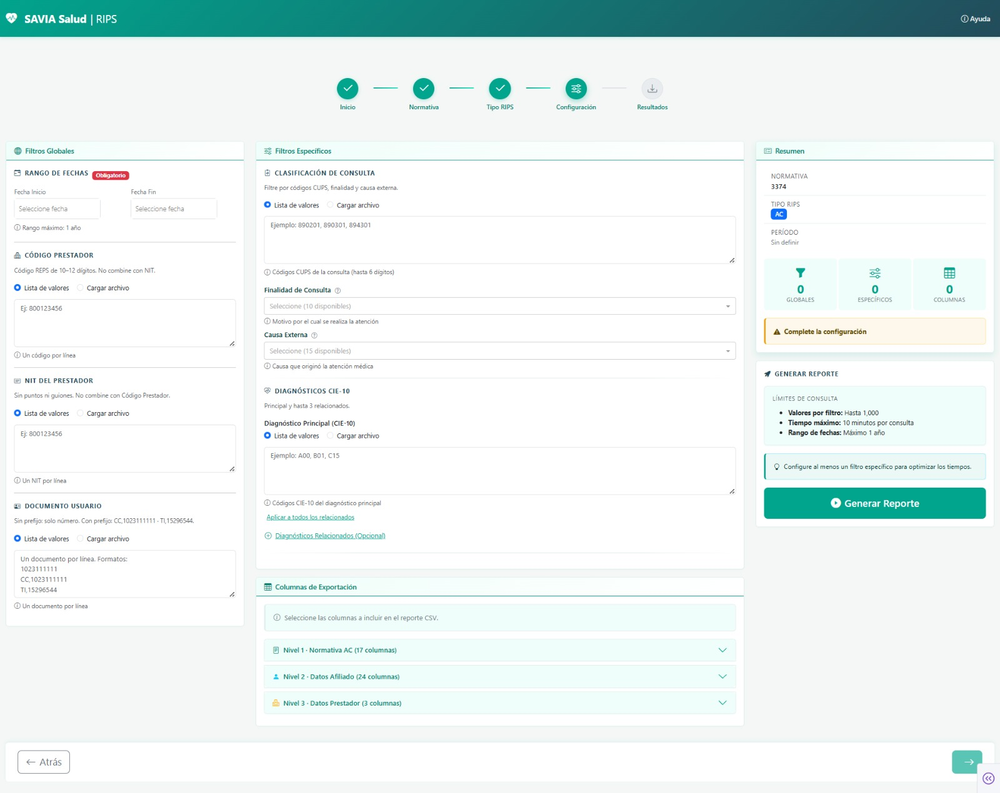

#### Selección de columnas por niveles

<table>
<tr>
<td width="33%"><b>Nivel 1</b> · 17 columnas normativas<br>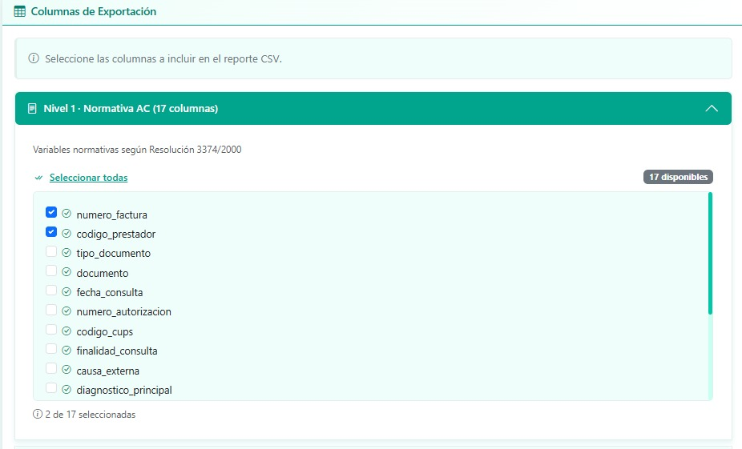</td>
<td width="33%"><b>Nivel 2</b> · 24 columnas de afiliado<br>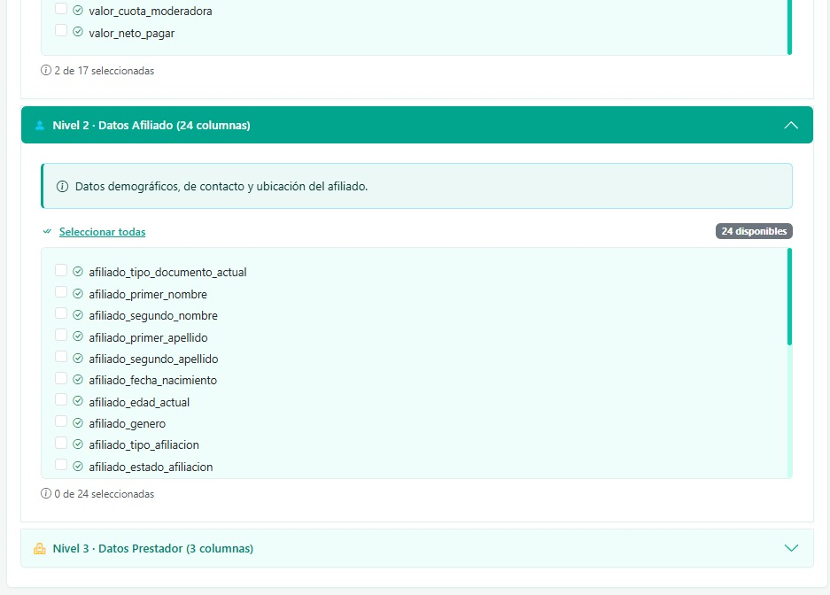</td>
<td width="33%"><b>Nivel 3</b> · 3 columnas de prestador<br>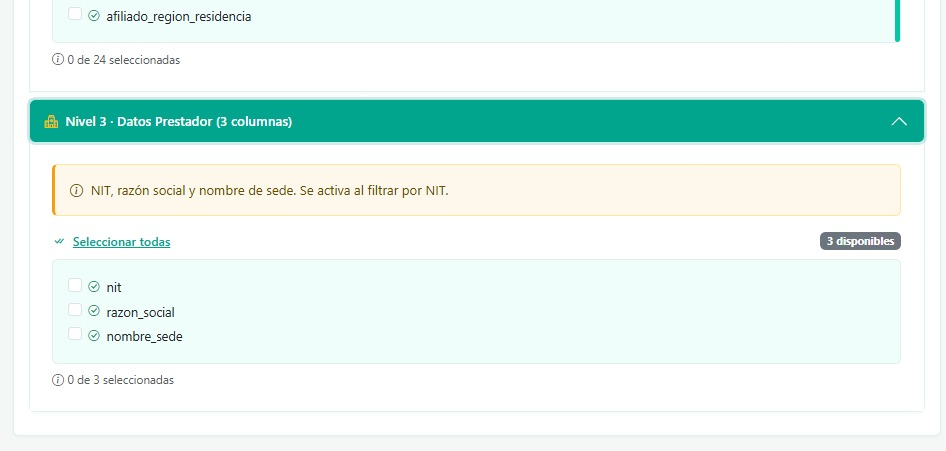</td>
</tr>
</table>

Las columnas de enriquecimiento (Niveles 2 y 3) **no se piden en el SQL**: se agregan en memoria solo si el usuario las selecciona (ver [decisiones](#-decisiones-técnicas-basadas-en-medición)).

#### Procesamiento
El resumen confirma que la configuración es válida y el botón pasa a estado "Procesando…" mientras corre el pipeline.

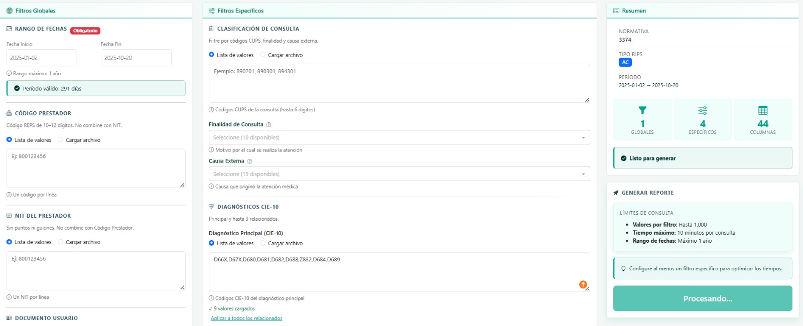

### 5. Resultado y descarga
Registros, tiempo de ejecución, tipo y período, más descarga directa del CSV con el nombre oficial.

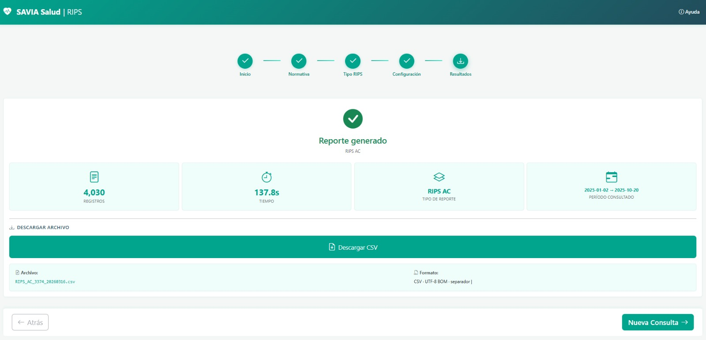

#### Archivo exportado (datos personales anonimizados)
El CSV incluye columnas normativas y descripciones automáticas de CUPS, finalidad, causa externa y diagnósticos (CIE-10).

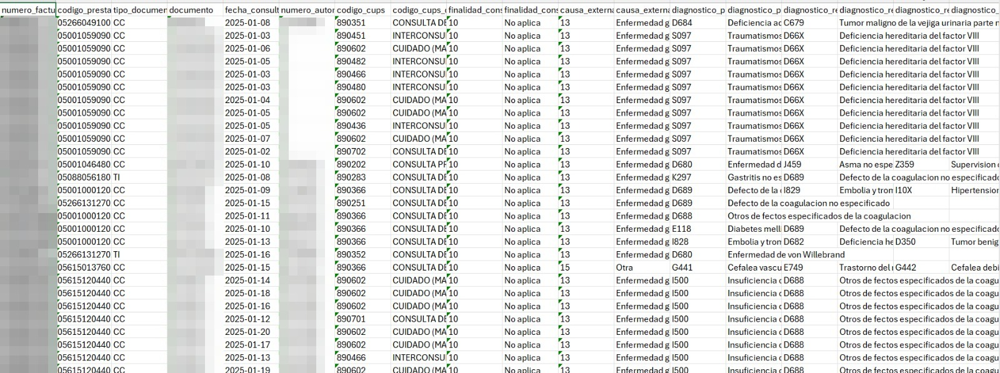

---

## 🏗️ Arquitectura

Arquitectura **MVC por capas** con responsabilidades estrictas:

| Capa | Responsabilidad | Regla |
|---|---|---|
| 🎨 Presentación | `views/`, `callbacks/` | Callbacks **delgados**: solo conectan UI con la lógica |
| ⚙️ Lógica | `controllers/`, `services/` | Controllers **orquestan**, services **ejecutan** |
| 🔧 Datos | `models/`, `utils/`, `config/` | Models = estructuras inmutables; utils = funciones puras |
| 🚀 Entrada | `app.py` | Solo inicialización |

### Fuentes de datos y enrutamiento automático

Los datos históricos están fragmentados por migraciones de sistemas. El usuario **no elige la fuente**: el sistema selecciona el conjunto mínimo de conexiones según el rango de fechas.

| Conexión | Motor | Normativa | Cobertura | Rol |
|---|---|---|---|---|
| 67 | MySQL | 3374 | 2013–presente | Histórico principal. Se filtra por registros en estado "procesado y validado" |
| 38 | PostgreSQL | 3374 | Solo 2020 | Fragmento de migración |
| 39 | MySQL | 3374 | 2013–2019 | Legacy |
| 82 | MySQL | 2275 | 2025–presente | Normativa moderna |

| Rango consultado | Conexiones |
|---|---|
| 2021 en adelante | 67 |
| Incluye 2020 | 67 + 38 + 39 (en paralelo) |
| 2013–2019 | 67 + 39 |
| Normativa 2275 | 82 |

### Pipeline ETL (9 fases, orden estricto)

```mermaid
flowchart LR
    A[1. Enrutar conexiones<br/>por fecha] --> B[2. Queries parametrizadas<br/>multi-BD en paralelo]
    B --> C[3. Consolidar y<br/>renombrar a estándar RIPS]
    C --> D[4. Normalizar<br/>catálogos]
    D --> E[5. Deduplicar]
    E --> F[6. Enriquecer afiliado<br/>Nivel 2]
    F --> G[7. Enriquecer prestador<br/>Nivel 3]
    G --> H[8. Descripciones<br/>CIE-10 / CUPS / catálogos]
    H --> I[9. Exportar CSV]
```

| # | Fase | Por qué importa |
|---|---|---|
| 1 | Determinación de conexiones | Evita consultas innecesarias (la mayoría usa solo la BD 67) |
| 2 | Ejecución multi-conexión | SQL parametrizado; excluye columnas de enriquecimiento del `SELECT` |
| 3 | Consolidación y renombrado | `pd.concat` tras mapear cada esquema al estándar RIPS |
| 4 | Normalización categórica | Códigos homogéneos entre BDs |
| 5 | **Deduplicación** | **Antes** del enriquecimiento (ver abajo) |
| 6 | Enriquecimiento Nivel 2 | Condicional: solo si el usuario eligió columnas de afiliado |
| 7 | Enriquecimiento Nivel 3 | `LEFT JOIN`, o `INNER JOIN` si hay filtro NIT |
| 8 | Descripciones | Se agregan para los códigos seleccionados |
| 9 | Exportación | UTF-8 BOM, `\|`, CRLF, fechas `YYYY-MM-DD`, nulos vacíos |

---

## 🧩 Problemas técnicos resueltos

### 1. Un mismo año repartido en 3 bases de datos
**Problema:** 2020 existe parcialmente en las conexiones 67, 38 y 39, con solapamientos.
**Solución:** consulta en paralelo, consolidación y deduplicación.
**Resultado:** 14,210 → 12,770 registros (1,440 duplicados eliminados).

### 2. Cada BD nombra y tipa los datos distinto
**Problema:** la misma variable tiene 4 nombres (`codigo_reps`, `codigo_ips_sede`, `cod_prestador`, `codPrestador`) y las fechas se almacenan como `DATE`, `TIMESTAMP` o `TEXT`.
**Solución:** un mapper por conexión (`ACFieldMapper`) y una estrategia de filtro de fecha por motor:

| Conexión | Tipo nativo | Estrategia |
|---|---|---|
| 67, 39 | `DATE` | `BETWEEN` |
| 38 | `TIMESTAMP` | `>= inicio AND < fin + 1 día` (no pierde el día límite) |
| 82 | `TEXT` mixto | `>= / <` + parser en cascada (5 formatos) + filtro estricto en Python |

El usuario siempre recibe nombres estándar RIPS, sin importar la fuente.

### 3. Orden de deduplicación vs. enriquecimiento
**Problema:** si se enriquece con datos del afiliado antes de deduplicar, un mismo registro difiere por dirección o teléfono entre conexiones y **no se detecta como duplicado**.
**Solución:** deduplicar primero, con solo valores RIPS ya normalizados, y enriquecer después.

### 4. Cambios legales de tipo de documento
**Problema:** un usuario atendido en 2020 como `TI` hoy figura como `CC` (TI→CC a los 18, RC→TI a los 7). Un JOIN por tipo + número lo perdería.
**Solución:** JOIN **solo por número de documento** y una columna derivada `cambio_tipo_documento` que marca la discrepancia. Captura todas las transiciones sin mapeos explícitos.

### 5. "Retirado" no es "Sin información"
**Problema:** no todo documento RIPS existe en la tabla de afiliados vigente.
**Solución:** `LEFT JOIN` con indicador de match. "Retirado" se conserva como estado válido (historial útil para auditoría legal); solo los documentos sin match se marcan como "Sin información" (error de captura o inexistente).

### 6. AM en Res. 3374 no tiene fecha propia
**Problema:** la tabla de dispensación de medicamentos no trae fecha del servicio.
**Solución:** `INNER JOIN` obligatorio con la tabla de facturas para filtrar por la fecha real. En 2275 la fecha es nativa y el JOIN no aplica.

### 7. Filtro por NIT en múltiples conexiones
**Problema:** solo la BD 67 contiene las tablas de prestadores; los registros de 38/39 no pueden filtrarse por NIT en SQL.
**Solución:** subquery en BD 67 + post-procesamiento en `PrestadorEnricher` para 38/39, garantizando consistencia del filtro.

---

## 🔬 Decisiones técnicas basadas en medición

| Decisión | Evidencia | Resultado |
|---|---|---|
| **Eliminar el `COUNT` preliminar** | Con `COUNT`: 71 s + 74.8 s = 145.8 s. Sin él: 74.6 s. La "mejora" aparente era solo calentamiento del buffer pool | −49 % y validación del límite de 750k **post-ejecución** |
| **`OR` en lugar de `UNION`** para diagnósticos | Sin índices, `UNION` hace 4 full scans: ~150 s vs ~73 s con `OR` | `OR` hoy; `UNION` cuando haya índices (esperado 5–10× más rápido) |
| **Enriquecer en pandas, no en el SQL base** | Queries más simples, reutilizables y fáciles de depurar | Los usuarios que no piden Nivel 2/3 no pagan el costo |
| **Un solo tipo RIPS por consulta** | Menos carga cognitiva y validaciones más predecibles | MVP entregado antes y con menos bugs |
| **Eliminar el modo de entrada "Manual"** | Redundante con "Lista"; menos superficie que mantener | UX más simple |
| **Pool de conexiones por BD** | Principal: `pool_size=10`, `max_overflow=4`. Resto: 5 y 2. `pool_pre_ping` y `pool_recycle=3600` | −40 a 60 % de latencia |

---

## 🛡️ Seguridad y validaciones

- **SQL parametrizado en el 100 % de los casos** (`:param`): la prevención de inyección es estructural, no por sanitización.
- **Dos capas de validación:** frontend (callbacks, instantáneo) y backend (controller, antes de ejecutar).
- Reglas: fecha obligatoria, rango máximo de 1 año y sin fechas futuras, ≥1 filtro específico, ≥1 columna, código de prestador **XOR** NIT, formato `TIPO,NUMERO` en documentos, hasta 1,000 valores por filtro, límite de 750,000 filas por archivo y tiempo máximo de 10 minutos.
- Errores amigables para el usuario; nunca se exponen trazas técnicas.
- Credenciales solo por variables de entorno (`.env`), nunca en el código.
- Logging por niveles (INFO / WARNING / ERROR / DEBUG) y cierre explícito de sesiones de BD.

---

## 🔎 Filtros soportados

| Ámbito | Filtros |
|---|---|
| **Globales** (AC, AP, AM) | Rango de fechas (obligatorio), código de prestador, NIT, documento del usuario (número o `TIPO,NUMERO`) |
| **AC** | CUPS, diagnóstico principal + relacionados 1/2/3 (con opción "aplicar a relacionados"), finalidad, causa externa |
| **AP** | Código de procedimiento, diagnósticos |
| **AM** | Código de medicamento, diagnósticos (2275) |

Entrada por **lista** o **archivo**; las 3 categorías de filtro (múltiples valores, categóricos, rango) comparten el mismo procesamiento backend.

---

## 🛠️ Stack

| Área | Tecnología |
|---|---|
| Lenguaje | Python 3.9+ |
| UI | Dash 3.3 (Bootstrap) |
| Acceso a datos | SQLAlchemy (pool configurado por BD) |
| ETL | pandas |
| Bases de datos | MySQL (×3) · PostgreSQL (×1) |
| Configuración | python-dotenv |

---

## 🧭 Estado y limitaciones conocidas

Honestidad sobre lo que quedó pendiente al cerrar el proyecto:

- **Rendimiento:** sin acceso a crear **índices** en las BDs de origen, no fue posible aplicar chunking temporal ni optimización SQL avanzada. Una consulta de ~4,000 registros con 9 diagnósticos tomó 137.8 s.
- **UX:** sin vista previa de datos (solo descarga directa) y sin barra de progreso funcional (limitación de Dash en el MVP).
- **Bugs menores identificados:** validación básica del CSV de entrada en filtros por archivo, retraso en bordes de cards (candidato a callbacks `clientside`) y estado inconsistente al recargar la página.
- **Fuera de alcance del MVP:** autenticación, logs de usuario, exportación a Excel nativo.

**Siguientes pasos:** índices en campos de diagnóstico y migración a `UNION`, chunking temporal, vista previa de las primeras 100 filas, barra de progreso, exportación `.xlsx` y autenticación.

---

## ▶️ Ejecución (referencia)

> El proyecto **no puede ejecutarse** sin acceso a las bases de datos originales. Se conservan los pasos como referencia.

```bash
git clone <repo-url>
cd rips-automation
python -m venv venv
source venv/bin/activate        # Windows: venv\Scripts\activate
pip install -r requirements.txt
cp .env.example .env            # completar credenciales de las 4 conexiones
python tests/test_connections.py  # valida conectividad
python app.py
```

---

## 📁 Organización del código

```text
rips-automation/
├── app.py          # Punto de entrada (solo setup)
├── config/         # Conexiones, pools y settings
├── models/         # Mapeos y estructuras por normativa y tipo RIPS
├── controllers/    # Orquestación del flujo por tipo (AC, AP, AM)
├── services/       # Query builders, procesamiento ETL, enriquecedores, exportador CSV
├── views/          # Componentes UI (wizard, filtros, resultados)
├── callbacks/      # Conectores UI ↔ lógica (delgados)
├── utils/          # Validadores, catálogos, manejo de archivos
├── tests/          # Pruebas de conectividad
└── assets/         # Estilos y JS cliente
```

---

## 🔒 Confidencialidad

Desarrollado para Savia Salud EPS. Este repositorio se publica como muestra de portafolio: no contiene credenciales ni datos reales, y las capturas fueron anonimizadas. La propiedad del código corresponde a la entidad.
